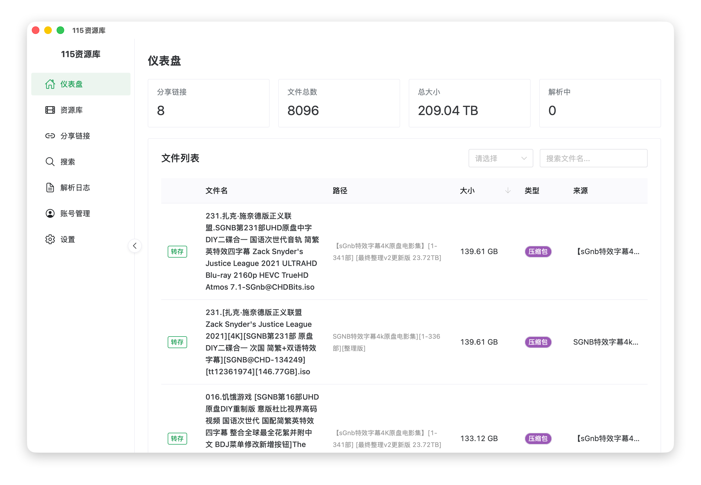

# 115ShareHub - 115 Cloud Resource Library

A desktop application based on Tauri 2 + Rust + Vue 3 used to parse file metadata from 115 Cloud share links and build a locally searchable resource library.



## Features

- **Share Link Parsing**: Enter a 115 share link to automatically recursively parse all file/directory information; supports automatic extraction of the extraction code from the URL (`?password=xxx`).
- **Resource Library**: Card-style display of completed share links. Clicking one allows you to browse folder structures, filter by type, search, and save files to your cloud.
- **Local Resource Library**: File metadata is stored in a local SQLite database, enabling searching without internet dependency.
- **Advanced Filter & Search**: Multi-dimensional filtering by filename, type (Video/Audio/Image/Document/ISO Disc/Subtitle/Folder, etc.), size range, and source link. Dual-path fuzzy search using FTS5 + LIKE, supporting partial filename matching.
- **Intelligent Rate Limiting + Anti-Ban**: Random request intervals of 1-4 seconds, automatic exponential backoff with jitter upon WAF detection, support for proxy rotation, and browser fingerprint spoofing (UA rotation, `sec-*` headers, native-tls).
- **Multi-Proxy Support**: HTTP / HTTPS / SOCKS5 proxies. Multiple proxies can be configured for automatic switching when one is banned.
- **Account Login**: Cookie login. Once logged in, you can parse restricted shares and save files/folders to your own 115 account with one click.
- **One-Click Save**: After logging in, select a target folder in Account Management, then click "Save" from the Dashboard, Search, or Resource Library. Supports saving entire folders while preserving the complete directory structure.
- **Folder Type Identification**: Subfolders are marked as `folder` type during parsing, supporting filtering and saving by folder.
- **Paginated Browsing**: Dashboard and Search pages support pagination with customizable items per page (10/20/50/100).
- **Parsing Logs**: Real-time display of the parsing process, including directory scanning, file statistics, and WAF interception warnings.
- **Mock Mode**: Set `MOCK_115_API=record` to cache API responses locally, or `=playback` for offline playback, allowing development and debugging without network access.

## Tech Stack

| Layer | Technology |
|------|------|
| Desktop Framework | Tauri 2 |
| Backend | Rust |
| Frontend | Vue 3 + TypeScript + Naive UI |
| Database | SQLite (rusqlite) + FTS5 |
| HTTP | reqwest (native-tls + socks) |

## Project Structure

```
├── src/                          # Vue 3 Frontend
│   ├── views/                    # Pages: Dashboard, Share Links, Search, Account Mgmt, Settings
│   ├── stores/                   # Pinia State Management
│   ├── router/                   # Vue Router (hash mode)
│   ├── types/                    # TypeScript Type Definitions
│   └── utils/                    # Utility functions & Tauri invoke wrappers
├── src-tauri/                    # Rust Backend
│   └── src/
│       ├── commands/             # Tauri Commands (Share Links, Search, Auth, Settings)
│       ├── db/                   # SQLite Data Layer (Schema, CRUD, FTS5)
│       └── pan115/               # 115 API Client (Parsing, Types, Rate Limiting, Mocking, Auth)
└── README.md
```

## Quick Start

### Environment Requirements

- Node.js 18+
- Rust 1.75+ (Install: `curl --proto '=https' --tlsv1.2 -sSf https://sh.rustup.rs | sh`)
- macOS / Windows / Linux

### Installation & Running

```bash
git clone https://github.com/a55ure/115ShareHub.git
cd 115ShareHub
npm install
npm run tauri dev
```

### Production Build

```bash
npm run tauri build
```

### Mock Mode (Offline Development)

```bash
# Record mode: Request 115 API and cache responses
MOCK_115_API=record npm run tauri dev

# Playback mode: Read from local cache only, no network
MOCK_115_API=playback npm run tauri dev
```

## How to Use

1. **Configure Proxy**: Go to "Settings" → "Proxy Settings" to add proxies (HTTP/SOCKS5) to avoid IP bans by 115. Multiple proxies can be added for automatic rotation.
2. **Account Login**: In "Account Management," paste the 115 Cookie copied from your browser. Once verified, advanced features like "Saving" will be unlocked.
3. **Add Share Link**: On the "Share Links" page, click "Add Link" and enter the 115 share URL. If the link contains an extraction code (`?password=xxx`), it will be identified automatically.
4. **Automatic Parsing**: The app will automatically recursively parse all files and directories from the link into the local database (large shares may be slow; lower the rate limit to avoid bans).
5. **Browse Files**: Enter a share link in the "Resource Library" to browse folder structures and filter by type (Video/Folder/Document, etc.).
6. **Advanced Search**: Use the "Search" page to filter by multiple dimensions (Type, Size, Source, etc.) with fuzzy matching support.
7. **Select Target Directory**: In "Account Management" → "Target Save Directory," expand the directory tree and click "Select" to set the destination for saving files.
8. **One-Click Save**: Click the "Save" button in the Resource Library, Dashboard, or Search results. Folders will be saved to the target directory while preserving the original structure.

## Development Roadmap

### Completed
- [x] Project scaffolding (Tauri 2 + Vue 3 + TypeScript)
- [x] SQLite database layer + FTS5 full-text search
- [x] 115 Share Link API client + recursive parsing
- [x] Share link management (Add/Delete/Refresh/Edit/Real-time progress)
- [x] Configurable rate limiting + WAF backoff + Proxy rotation
- [x] Dashboard + Advanced search page
- [x] Resource library page (Card-style browsing + Folder navigation)
- [x] Cookie login + Account management
- [x] One-click save to specified directory (Files + Folders, preserving structure)
- [x] Multi-proxy support (HTTP/HTTPS/SOCKS5)
- [x] Mock/Record mode for offline development
- [x] FTS5 + LIKE dual-path fuzzy search
- [x] Paginated browsing (Dashboard/Search, customizable items per page)
- [x] Anti-WAF: UA rotation, browser fingerprints, native-tls, backup endpoints
- [x] File type extensions: ISO discs, subtitle files
- [x] Real-time WAF interception alerts
- [x] Folder type identification (marked as `folder` during parsing, supports filtering/saving)
- [x] Automatic extraction code detection (supports `?password=xxx` parameter)
- [x] Parsing log module (real-time parsing process display)
- [x] Parsing progress display (progress bars on share link page + file/directory counts)

### Next Phase
- [ ] Duplicate link detection (De-duplication)
- [ ] QR code login (`qrcodeapi.115.com` endpoint configured, pending test)
- [ ] Batch adding of share links
- [ ] Dark mode refinement
- [ ] Database export/import
- [ ] Duplicate file detection (based on SHA1)

### Future Plans
- [ ] Offline download management
- [ ] Support for multiple cloud drives (Alibaba Cloud Drive, Baidu Netdisk, etc.)
- [ ] Automatic updates (Tauri updater)
- [ ] Windows / Linux compatibility testing

## Database Design

- `share_links` — Share links (share_code, receive_code, title, status, file statistics)
- `files` — File metadata (name, size, sha1, file_type, full_path, thumbnail, parent_id)
- `files_fts` — FTS5 full-text search virtual table (unicode61 tokenizer)
- `settings` — Application settings (key-value pairs)

## References

- [AList](https://github.com/alist-org/alist) — Reference for 115 API analysis (endpoints, login, saving)
- [115driver](https://github.com/SheltonZhu/115driver) — 115 driver implemented in Go
- [TgtoDrive](https://github.com/walkingddd/TgtoDrive) — Reference for 115 save API (`/share/receive` with target folder cid)
- [115sharebatchsave](https://github.com/AAlexDing/115sharebatchsave) — Reference for 115 batch saving
- [Tauri](https://tauri.app/) — Cross-platform desktop application framework
- [Naive UI](https://www.naiveui.com/) — Vue 3 component library

## License

MIT
